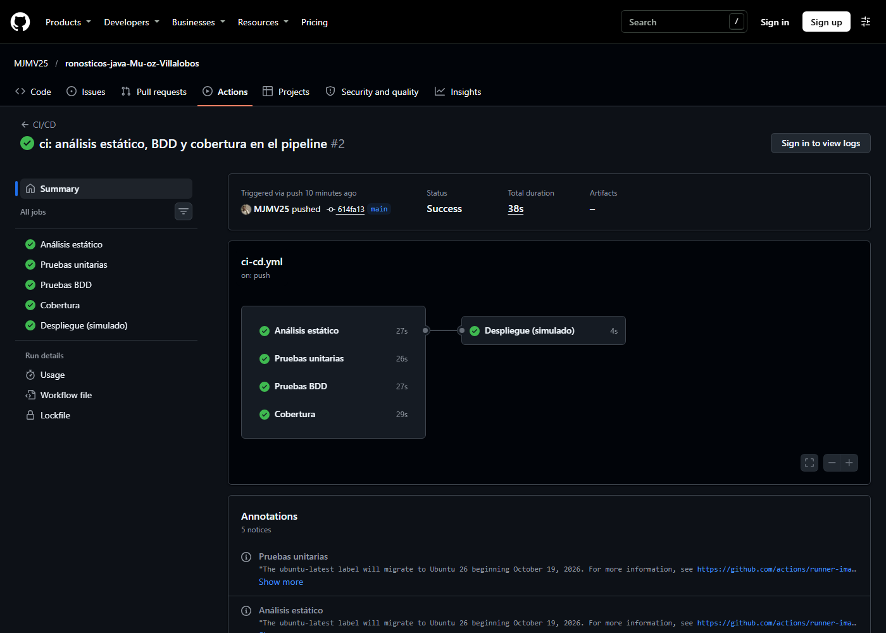
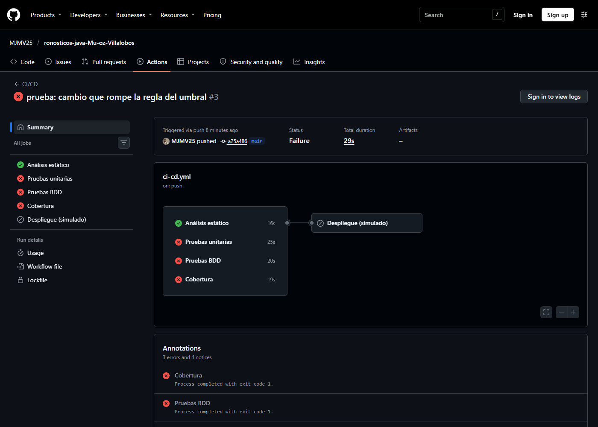
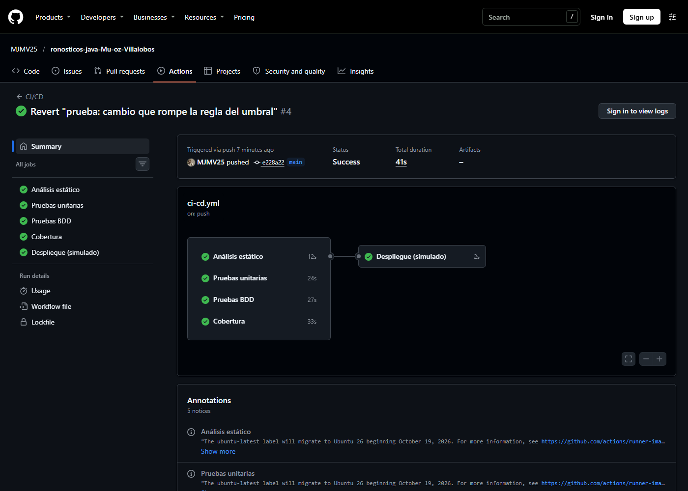
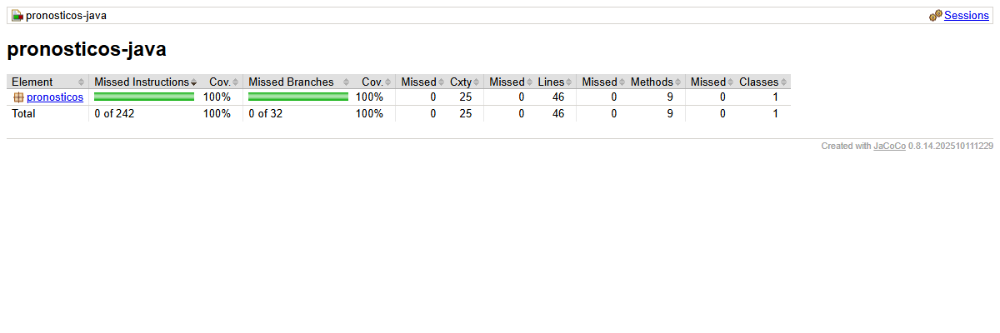
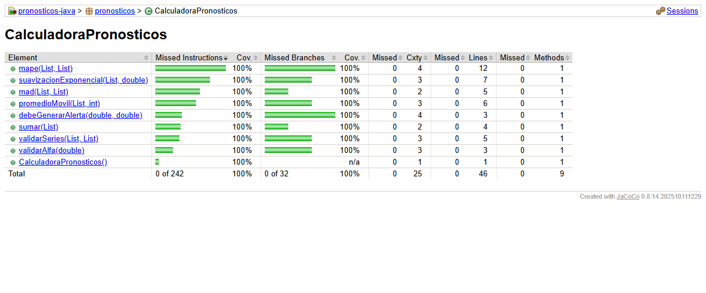

# Informe · Pruebas de la Unidad 2 y pipeline de CI/CD

**Estudiante:** Manuel José Muñoz Villalobos

## 1. Repositorio

https://github.com/MJMV25/ronosticos-java-Mu-oz-Villalobos

## 2. Pipeline en rojo y en verde

### Verde: todo el pipeline completo (Paso 7.4)

Los cuatro jobs de verificación pasan y, como todos terminaron bien, corre el despliegue.
[Ver ejecución](https://github.com/MJMV25/ronosticos-java-Mu-oz-Villalobos/actions/runs/43141001670)

### Rojo: cambio que rompe la regla del umbral (Paso 7.5)

Cambiamos `>=` por `>` en `debeGenerarAlerta`. Fallan *Pruebas unitarias*, *Pruebas BDD* y *Cobertura*;
*Análisis estático* pasa, y el *Despliegue (simulado)* aparece omitido: no corrió.
[Ver ejecución](https://github.com/MJMV25/ronosticos-java-Mu-oz-Villalobos/actions/runs/43141305498)

### Verde de nuevo, después de `git revert` (Paso 7.5)

[Ver ejecución](https://github.com/MJMV25/ronosticos-java-Mu-oz-Villalobos/actions/runs/43141462243)

## 3. Reporte de cobertura de JaCoCo

Resultado de `mvn verify`: 27 pruebas (24 unitarias y 3 escenarios BDD), 0 fallas, `All coverage checks have been met`.
Cobertura de 100 % en líneas (46 de 46) y en ramas (32 de 32).

## 4. Preguntas

**¿Qué vieron en el rojo del Paso 2.1 y por qué en Java suele ser un error de compilación?**

Vimos `COMPILATION ERROR` con `cannot find symbol` sobre `suavizacionExponencial`. La prueba no llegó a
ejecutarse: falló antes, al compilar. Java es de tipado estático y el compilador revisa que cada método que se
llama exista en la clase antes de generar el programa. Como la prueba llamaba a un método que todavía no estaba
en `CalculadoraPronosticos`, el código no compilaba. En un lenguaje dinámico, como Python, el rojo aparecería
al ejecutar la prueba; en Java aparece antes, al compilar.

También notamos algo en el Paso 2.3: las pruebas de alfa 0 y alfa 1 pasaron sin ponerse en rojo, porque el
código del Paso 2.2 ya era más que el mínimo y cubría esos casos. La prueba de alfa fuera de rango sí falló,
porque el mensaje de la excepción no era el que pedía la especificación. Ahí corregimos el código.

**¿Por qué el MAPE del caso `[80, 0, 95]` se divide entre 2?**

Porque el MAPE es un error porcentual: cada error se divide entre la demanda real de su periodo. En el
segundo periodo la demanda real es 0, y dividir entre 0 no tiene sentido, así que ese periodo se excluye. Solo
quedan 2 periodos válidos: el primero, con 0 % de error (80 contra 80), y el tercero, con 5/95 = 5,263 %. El
promedio se saca sobre los periodos que sí se usaron: 5,263 / 2 = 2,63 %. Si se dividiera entre 3, el periodo
excluido contaría como si tuviera 0 % de error y el resultado quedaría artificialmente bajo.

**¿Por qué las pruebas unitarias crean la calculadora con `new` en lugar de levantar Spring?**

Porque una prueba unitaria debe probar una unidad aislada, y `CalculadoraPronosticos` es Java puro: no depende
de Spring, de la base de datos ni de la red. Crearla con `new` hace que cada prueba tarde milisegundos y no
dependa del entorno. Levantar Spring arrancaría todo el contexto de la aplicación y el servidor, lo que haría
las pruebas más lentas y haría que pudieran fallar por algo ajeno a la regla de negocio. Así se cumple FIRST,
sobre todo *Fast*, *Independent* y *Repeatable*. Spring solo se usa en la aplicación real, donde
`PronosticosApplication` registra la calculadora como bean.

**¿Qué diferencia hay entre una prueba unitaria y un escenario BDD en este proyecto?**

Las dos terminan llamando al mismo método, `debeGenerarAlerta`, pero están escritas para públicos distintos.
La prueba unitaria (`AlertasTest`) está escrita en Java por y para desarrolladores. Revisa el método con
detalle, incluso casos técnicos como el umbral fuera de rango, que debe lanzar `IllegalArgumentException`. El
escenario BDD (`alertas.feature`) está escrito en español con Dado / Cuando / Entonces. Describe la regla de
negocio de forma que alguien de Producción pueda leerla y confirmar que "un error igual al umbral sí alerta"
es lo que necesita. Cucumber conecta cada frase con un método de `AlertasSteps`, y así esa misma descripción se
ejecuta como prueba.

**En el Paso 7.5, ¿qué pruebas fallaron y por qué el despliegue no corrió?**

Al cambiar `>=` por `>`, un error exactamente igual al umbral dejó de generar alerta. Fallaron:

- La prueba unitaria `AlertasTest.alertaCuandoElErrorEsIgualAlUmbral` (error 10, umbral 10: esperaba `true`
  y obtuvo `false`). Por eso falló el job *Pruebas unitarias*.
- El escenario BDD *"El error es igual al umbral"* (`Se esperaba una alerta ==> expected: <true> but was:
  <false>`). Por eso falló el job *Pruebas BDD*.
- El job *Cobertura* también falló, porque `mvn verify` corre todas las pruebas, incluidas esas dos.

Las demás pruebas siguieron pasando, porque con 12 % y 7 % el resultado no cambia. *Análisis estático* pasó
porque Checkstyle revisa la forma del código, no si la lógica es correcta, y el código roto seguía bien escrito.

El despliegue no corrió porque tiene `needs: [analisis-estatico, pruebas-unitarias, pruebas-bdd, cobertura]`:
GitHub Actions solo lo ejecuta si los cuatro jobs terminan bien. Como tres fallaron, lo omitió, y el cambio
roto no llegó a "producción". Después de `git revert` el pipeline volvió a verde y el despliegue corrió.
